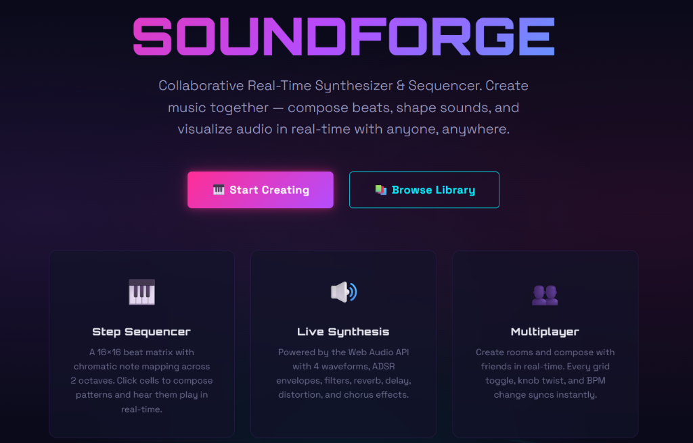

# 🎹 SoundForge — Collaborative Real-Time Synthesizer & Sequencer

> A collaborative, in-browser digital audio studio. Compose 16×16 drum & melodic patterns, sculpt modular sound synthesis with Tone.js, and jam simultaneously with peers across real-time multiplayer rooms.

[](https://soundforge-frontend.vercel.app/)
[](https://react.dev/)
[](https://tonejs.github.io/)
[](https://socket.io/)
[](https://soundforge-api.onrender.com)
[](LICENSE)

---

### 🌐 Live Deployments
- **Interactive Music Studio (Frontend)**: [https://soundforge-frontend.vercel.app/](https://soundforge-frontend.vercel.app/)
- **Multiplayer & Storage API (Backend)**: [https://soundforge-api.onrender.com/](https://soundforge-api.onrender.com/)

---



---

## 📌 Overview

**SoundForge** turns the modern web browser into an interactive, multi-user audio playground. Designed for electronic musicians, beatmakers, and casual creators alike, it pairs high-precision Web Audio synthesis with low-latency WebSockets.

Musicians can launch an instant jam session, share their unique Room ID with friends, and collaboratively edit sequencer grids, adjust BPM tempos, twist synthesizer filter knobs, and shape sounds together with zero configuration.

---

## ✨ Key Features

- **🎛️ 16×16 Multi-Track Step Sequencer**:
  - Chromatic 2-octave note mapping.
  - Interactive clickable beat matrix with real-time playback playhead animation.
  - Polyphonic voice playback driven by Tone.js precision transport scheduling.
- **🔊 Live Sound Synthesis Engine**:
  - **4 Waveforms**: Sine, Square, Sawtooth, and Triangle oscillators.
  - **ADSR Envelope**: Full control over Attack, Decay, Sustain, and Release parameters.
  - **Audio Effects Rack**: Low-pass filter, algorithmic reverb, stereo ping-pong delay, distortion, and chorus.
- **👥 Real-Time Multiplayer Jamming (Socket.io)**:
  - Create and join public or private studio rooms.
  - Sub-millisecond synchronization of step activations, tempo/BPM changes, instrument presets, and synth parameters.
  - Presence indicator showing active peers in the session.
- **🌊 Interactive Audio Visualizer**:
  - HTML5 Canvas frequency spectrum and oscilloscope rendering waveforms in real time.
- **💾 Pattern Library & Presets**:
  - Save custom sequences to the cloud and browse the community pattern library.

---

## 🛠️ Architecture & Tech Stack

```text
┌─────────────────────────────────┐         Socket.io (Room Events)       ┌─────────────────────────────────┐
│     SoundForge Client           │ <===================================> │      SoundForge API             │
│  (React 19, Tone.js, Canvas)    │              HTTP REST                │    (Express 5, Mongoose)        │
└─────────────────────────────────┘ ------------------------------------> └─────────────────────────────────┘
```

| Layer | Technology |
| :--- | :--- |
| **Framework** | React 19, Vite |
| **Audio Processing** | Tone.js v15, Web Audio API |
| **Real-Time Sync** | `socket.io-client` v4 |
| **Routing** | React Router DOM v7 |
| **Visuals** | HTML5 Canvas API (Oscilloscope & Audio Spectrogram) |
| **Hosting** | Vercel (Edge CDN) |
| **Companion Backend** | [SoundForge Backend (Node.js / Express)](https://github.com/kumarrishi4981/soundforge-backend) |

---

## 📂 Project Structure

```text
soundforge-frontend/
├── src/
│   ├── audio/                   # Tone.js synth definitions, effects chains & transport
│   ├── components/              # UI Components
│   │   ├── SequencerGrid.jsx    # 16x16 interactive step sequencer
│   │   ├── SynthControls.jsx    # ADSR sliders, filter cutoffs, waveform selectors
│   │   ├── Visualizer.jsx       # Canvas audio spectrum visualizer
│   │   └── RoomBar.jsx          # Multiplayer room manager & user presence
│   ├── pages/                   # Landing page, Studio / Sequencer, Library
│   ├── socket/                  # Socket.io connection manager & event dispatchers
│   ├── App.jsx                  # Main router & audio context provider
│   └── index.css                # Dark neon cyber-audio aesthetic
├── public/                      # Static assets & favicons
├── package.json
└── README.md                    # Documentation
```

---

## 🚀 Local Development Setup

### Prerequisites
- **Node.js** (v18+) and **npm**
- Running instance of [SoundForge Backend](https://github.com/kumarrishi4981/soundforge-backend) (optional for offline single-player mode)

---

### 1. Clone the Repository
```bash
git clone https://github.com/kumarrishi4981/soundforge-frontend.git
cd soundforge-frontend
```

### 2. Install Dependencies
```bash
npm install
```

### 3. Configure Environment Variables
Create a `.env` file in the root directory:
```env
VITE_API_URL=http://localhost:5000
VITE_SOCKET_URL=http://localhost:5000
```

### 4. Run Development Server
```bash
npm run dev
```
* Open your browser at `http://localhost:5173`. Click anywhere on the interface to initialize the browser's Web Audio Context!

---

## ☁️ Deployment (Vercel)

1. Import the repository on **[Vercel](https://vercel.com/)**.
2. Configure environment variables:
   - `VITE_API_URL` = `https://soundforge-api.onrender.com`
   - `VITE_SOCKET_URL` = `https://soundforge-api.onrender.com`
3. Click **Deploy**.

---

## 🤝 Contributing
Contributions, synth sound presets, and feature ideas are welcome!
1. Fork the Project
2. Create your Feature Branch (`git checkout -b feature/MidiControllerSupport`)
3. Commit your Changes (`git commit -m 'feat: Add Web MIDI input support'`)
4. Push to the Branch (`git push origin feature/MidiControllerSupport`)
5. Open a Pull Request

---

## 📄 License
This project is open-source under the **MIT License**.

---

## 👤 Author
- **Rishi Kumar**
- GitHub: [@kumarrishi4981](https://github.com/kumarrishi4981)
- Live App: [SoundForge on Vercel](https://soundforge-frontend.vercel.app/)
